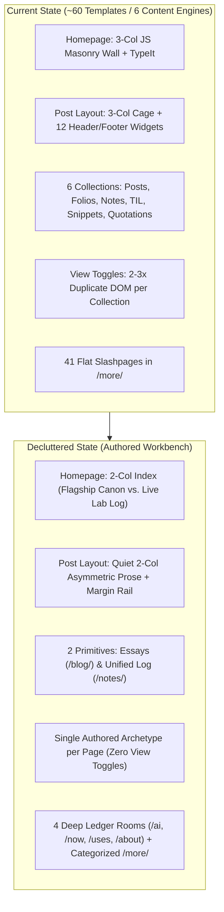

# The Declutter Project: Master Architecture & Execution Plan

- **Branch**: `declutter` (branched cleanly from `main` @ `effbfe7`)
- **Goal**: Strip away accumulated platform chrome, duplicate DOM trees, fractured content taxonomies, and slashpage sprawl so `carteakey.dev` reads like an authored notebook and high-density personal workbench.
- **Execution Rule**: Every module below is self-contained. After completing any module (or sub-module checkpoint), run `npm run check` (`check:version`, `check:content`, `check:design`, `verify`) and commit before moving to the next module.

---

## Architecture Transformation Overview

---

## Module 1: Information Architecture & Nesting Under `/ai/`

**Objective**: Group AI sub-pages under `/ai/`, merge duplicate quote collections, retire redundant sitemap pages, and turn `/more/` into a 4-column categorized directory.

### 1.1 Nest `/skills/` and `/prompts/` under `/ai/`
- [x] **Move Skills to `/ai/skills/`**:
  - [x] Update permalink in [`src/skill-library.njk`](file:///home/kchauhan/repos/carteakey.dev/src/skill-library.njk) from `/skills/` to `/ai/skills/`.
  - [x] Update individual skill layout [`src/_includes/layouts/skill.njk`](file:///home/kchauhan/repos/carteakey.dev/src/_includes/layouts/skill.njk) breadcrumbs to point to `/ai/` → `/ai/skills/`.
  - [x] Add sub-navigation ledger rail across `/ai/`, `/ai/skills/`, `/ai/prompts/`, and `/folio/model-tier-list/`.
- [x] **Move Prompts to `/ai/prompts/`**:
  - [x] Update permalink in [`src/prompts.njk`](file:///home/kchauhan/repos/carteakey.dev/src/prompts.njk) from `/prompts/` to `/ai/prompts/`.
  - [x] Update [`src/prompts/prompts.json`](file:///home/kchauhan/repos/carteakey.dev/src/prompts/prompts.json) (or frontmatter permalink pattern) so prompt entries resolve under `/ai/prompts/{{ page.fileSlug }}/` (or keep permalinks with 301s).
- [x] **Redirects & Checks**:
  - [x] Add 301 redirects in [`src/_redirects`](file:///home/kchauhan/repos/carteakey.dev/src/_redirects) for `/skills/` → `/ai/skills/` and `/prompts/` → `/ai/prompts/` (plus wildcard `/prompts/:splat` → `/ai/prompts/:splat`).
  - [x] Update internal links in [`src/ai.njk`](file:///home/kchauhan/repos/carteakey.dev/src/ai.njk), [`src/more.njk`](file:///home/kchauhan/repos/carteakey.dev/src/more.njk), and [`src/_includes/layouts/base.njk`](file:///home/kchauhan/repos/carteakey.dev/src/_includes/layouts/base.njk).

### 1.2 Merge `/quotes/` and `/quotations/`
- [x] **Unify into `/quotes/` ([`src/quotes.njk`](file:///home/kchauhan/repos/carteakey.dev/src/quotes.njk))**:
  - [x] Keep Quote of the Day at the top of `/quotes/`.
  - [x] Render the 5 annotated markdown entries from `src/quotations/*.md` (with their commentary and context) alongside the curated quotes from `src/_data/quotes.js` in a single cohesive layout.
  - [x] Remove [`src/quotations.njk`](file:///home/kchauhan/repos/carteakey.dev/src/quotations.njk) from `eleventyNavigation` and replace it with a 301 redirect `/quotations/` → `/quotes/` in [`src/_redirects`](file:///home/kchauhan/repos/carteakey.dev/src/_redirects).
  - [x] Remove `"src/quotations.njk": "index"` from `ARCHETYPE_PAGES` in [`utils/check-content.mjs`](file:///home/kchauhan/repos/carteakey.dev/utils/check-content.mjs).

### 1.3 Redesign `/more/` into a 4-Column Categorized Workbench Directory
- [x] **Replace flat alphabetical `<ul>` in [`src/more.njk`](file:///home/kchauhan/repos/carteakey.dev/src/more.njk)** with a 4-section `.surface` ledger grid:
  - [x] **Column 1 — Writing & Canon**: `/blog`, `/notes` (The Log), `/folio`, `/reviews`, `/tags`, `/search`
  - [x] **Column 2 — AI & Homelab**: `/ai`, `/folio/model-tier-list`, `/ai/skills`, `/ai/prompts`, `/status`
  - [x] **Column 3 — Shelves & Media**: `/now`, `/reading`, `/watching`, `/listening`, `/games`, `/gallery`, `/vibes`, `/quotes`, `/bookmarks`, `/blogroll`
  - [x] **Column 4 — Person & Meta**: `/about`, `/uses`, `/projects`, `/cv`, `/data`, `/workouts`, `/guestbook`, `/newsletter`, `/colophon`, `/changelog`, `/stats`
- [x] Remove user-facing links to `/page-list/` and `/more/` self-link from [`src/more.njk`](file:///home/kchauhan/repos/carteakey.dev/src/more.njk).

---

## Module 2: Content Taxonomy Consolidation (`Essays` vs. `The Log`)

**Objective**: Reduce 6 separate writing collections into 2 clear reader mental models: **Essays (`/blog/`)** for long-form writing/series, and **The Log (`/notes/`)** for all short-form observations, TILs, and code snippets.

### 2.1 Build the Unified Log at `/notes/` ([`src/notes.njk`](file:///home/kchauhan/repos/carteakey.dev/src/notes.njk))
- [x] **Create a `collections.log` collection in [`eleventy.config.mjs`](file:///home/kchauhan/repos/carteakey.dev/eleventy.config.mjs)**:
  - [x] Merge `notes` (`src/notes/*.md`), `til` (`src/til/*.md`), and `snippets` (`src/snippets/*.md`) into one reverse-chronological stream with normalized `.type` (`note`, `til`, `snippet`).
- [x] **Add lightweight Alpine filter pills at the top of [`src/notes.njk`](file:///home/kchauhan/repos/carteakey.dev/src/notes.njk)**:
  - [x] `All` · `Notes` · `Code Snippets` · `TIL` (syncing with URL hash or query param `?type=snippet` so direct links work).
  - [x] Preserve the tag filter and search input for code snippets when filtering by `Code Snippets`.
- [x] **Redirect standalone index pages while preserving item permalinks**:
  - [x] Keep individual item permalinks (`/notes/...`, `/snippets/...`, `/til/...`) intact so no external links or syndication URLs (`tweet_url`) break.
  - [x] Redirect `/til/` → `/notes/?type=til` and `/snippets/` → `/notes/?type=snippet` in [`src/_redirects`](file:///home/kchauhan/repos/carteakey.dev/src/_redirects) (or keep lightweight pre-filtered views and remove them from top-level navigation).
  - [x] Retire the redundant HTML `/feed/` page (redirect `/feed/` → `/notes/`), while keeping `/feed/feed.xml` and `/feed/feed.json` untouched.

---

## Module 3: Retire View Toggles & Duplicate DOM Trees

**Objective**: Commit to a single authored layout per page archetype, stop rendering 2–3x duplicate DOM trees per collection, and move the AI Authorship filter out of the global navbar into the collection toolbar.

### 3.1 Commit Each Collection to One Archetype
- [x] **`/blog/` ([`src/archive.njk`](file:///home/kchauhan/repos/carteakey.dev/src/archive.njk)) → Index Archetype**:
  - [x] Keep the dense chronological list view (with `Pinned` section, year jump bar, and sketch stamp thumbnails).
  - [x] Delete the hidden `x-show="view === 'grid'"` masonry duplicate DOM and view-toggle toolbar.
- [x] **`/notes/` ([`src/notes.njk`](file:///home/kchauhan/repos/carteakey.dev/src/notes.njk)) → Stream Archetype**:
  - [x] Keep the readable chronological stream view (with inline note prose, media, and code).
  - [x] Delete the hidden `list` and `grid` duplicate DOM trees and `feed-masonry-script.njk` include.
- [x] **`/projects/` ([`src/projects.njk`](file:///home/kchauhan/repos/carteakey.dev/src/projects.njk)) → Wall Archetype**:
  - [x] Keep the project wall grid.
  - [x] Delete the hidden `list` duplicate DOM tree and view-toggle toolbar.
- [x] **Clean up unused view-toggle plumbing**:
  - [x] Remove [`src/_includes/components/view-toggle.njk`](file:///home/kchauhan/repos/carteakey.dev/src/_includes/components/view-toggle.njk) and `src/static/js/collection-views.js` once no template imports them.
  - [x] Update [`utils/verify-ui.mjs`](file:///home/kchauhan/repos/carteakey.dev/utils/verify-ui.mjs#L248-L263) assertions to verify the single canonical layout on `/blog/`, `/notes/`, and `/projects/`.

### 3.2 Relocate the AI Authorship Filter
- [x] **Remove the global `filter` icon dropdown from [`src/_includes/layouts/base.njk`](file:///home/kchauhan/repos/carteakey.dev/src/_includes/layouts/base.njk#L203-L221)**:
  - [x] Leaves the top header clean with only `About`, `Writing`, `Now`, `AI`, Search, `/more/` Compass, and Dark Mode.
- [x] **Add a compact inline Authorship Filter pill in `/blog/` and `/notes/` toolbars**:
  - [x] `All · Human + Assisted · Human Only` right next to the search/filter bar where `data-authored-by` items actually live.

---

## Module 4: Homepage Redesign — Architectural Index vs. Live Log

**Objective**: Replace the 3-column JS masonry wall and TypeIt animation on [`src/index.njk`](file:///home/kchauhan/repos/carteakey.dev/src/index.njk) with a deliberate 2-column workbench layout that separates Flagship Writing from the Daily Lab Log.

### 4.1 Clean Up the Homepage Intro ([`src/index.njk`](file:///home/kchauhan/repos/carteakey.dev/src/index.njk#L12-L43))
- [x] Remove `<script src="/static/js/typeit.min.js">` and the `
` element (which duplicates the static dek immediately below it).
- [x] Update `.home-link-row` to highlight the core workbench rooms: `About` · `Now` · `AI` · `Projects` · `Writing` · `Log` · `GitHub ↗`.

### 4.2 Replace the 3-Column Masonry Grid with a 2-Column Workbench Split
- [x] **Left Column (`lg:col-span-7`) — Flagship Essays, Series & Folios**:
  - [x] **Pinned / Featured Essays**: Top 4–5 flagship posts with monochrome sketch stamps, date, reading time, and subtitle dek.
  - [x] **Research Series & Folios Shelf**: Compact 2x2 ledger cards for **Local Inference** (`/blog/local-inference/`), **Coding Agents** (`/blog/agents/`), **Sortling** (`/blog/sortling/`), and **The AI Model Tier List** (`/folio/model-tier-list/`).
  - [x] **Recent Essays**: Clean chronological index rows of the latest 5 posts (`All writing →`).
- [x] **Right Column (`lg:col-span-5`) — The Live Lab Log**:
  - [x] Compact `.surface` chronological ticker of the latest 10 short-form entries from `collections.log` (Notes, TILs, Snippets).
  - [x] Each row shows `[TYPE]` mono badge, date, title (or compact 2-line note preview), and `tweet_url` indicator if syndicated (`Full log →`).
- [x] Remove `` from [`src/index.njk`](file:///home/kchauhan/repos/carteakey.dev/src/index.njk).

---

## Module 5: Post Reading Experience Declutter ([`post.njk`](file:///home/kchauhan/repos/carteakey.dev/src/_includes/layouts/post.njk))

**Objective**: Strip away the 3-column cage and 12 header/footer widgets so long-form technical posts read like a calm, authoritative notebook page.

### 5.1 Shift from 3-Column Cage to 2-Column Asymmetric Layout
- [x] **Remove the Left Sidebar Author Bio Card ([`post.njk`](file:///home/kchauhan/repos/carteakey.dev/src/_includes/layouts/post.njk#L59-L94))**:
  - [x] Delete the redundant headshot/bio box on posts (keep `editorial-sidebar.njk` only if a post explicitly declares `theme: editorial` and `sidebar`).
  - [x] Update `.post-wrap` in [`src/static/css/tailwind.css`](file:///home/kchauhan/repos/carteakey.dev/src/static/css/tailwind.css) to a clean 2-column grid (`minmax(0, 44rem) 16rem` at `xl+`): prose on the left, sticky Outline + `` margin notes on the right.
  - [x] Simplify the `--wide-bleed` resize script since wide tables only need to respect the right rail.

### 5.2 Compress Pre-Post Chrome into a Single Monospace Ledger Rail
- [x] **Replace the 3 separate header blocks** (colored AI disclaimer box, 4-chip meta row with live view count, and standalone Copy Markdown row) with **one compact mono ledger bar** below `.post-dek`:
  - [x] `2026-10-03 · 12 min read · #AI #Self-Host · [AI-Assisted] · [Copy .md]`
  - [x] Clicking `[AI-Assisted]` or hovering shows the authorship note in a clean tooltip/disclosure instead of a permanent 3-line blue/purple alert banner above every post.
  - [x] Remove `#viewCount` / `#viewCountNumber` from the header so page load doesn't flash `- views`.

### 5.3 Fix Mobile Outline & Prune Post-Footer Bloat
- [x] **Move Mobile Table of Contents to the Top**:
  - [x] Move the `xl:hidden` Outline from line 814 (below Giscus comments!) to a collapsible `
` immediately before `.post-body`.
- [x] **Remove Post-Footer Clutter**:
  - [x] Remove `<section class="learning-post-panel">` ("Reading tracker / Mark as read") and `<script defer src="/static/js/learning-progress.js">` ([`post.njk`](file:///home/kchauhan/repos/carteakey.dev/src/_includes/layouts/post.njk#L269-L287)).
  - [x] Remove `#postReactions` (5-emoji bar) and its 120-line client-side fetch script ([`post.njk`](file:///home/kchauhan/repos/carteakey.dev/src/_includes/layouts/post.njk#L289-L332), [`L464-L585`](file:///home/kchauhan/repos/carteakey.dev/src/_includes/layouts/post.njk#L464-L585)).
  - [x] Combine the **Upvote button**, **Updated date**, and **Copy Markdown** into a single clean end-of-article sign-off bar above the Series/Next-Prev links and Giscus comments.

---

## Module 6: Consolidate Slashpages into 4 Cohesive Ledger Rooms

**Objective**: Turn thin standalone slashpages into 4 deep, interconnected Ledger rooms while keeping legacy URLs working via anchors or 301 redirects.

- [x] **Room 1 — `/ai/` (The AI & Homelab Hub)**:
  - [x] Connect `/ai/`, `/folio/model-tier-list/`, `/ai/skills/`, and `/ai/prompts/` with a shared top sub-ledger navigation bar.
  - [x] Fold the standalone `/devices/yeti-cachy/` spec details into `/ai/#homelab` (and `/uses/#hardware`).
- [x] **Room 2 — `/now/` (The Live Media & Life Ledger)**:
  - [x] Enhance [`src/now.njk`](file:///home/kchauhan/repos/carteakey.dev/src/now.njk) so the Goodreads (`reading`), Letterboxd (`watching`), Spotify (`listening`), and Steam (`games`) sections read as a unified 2x2 Media Ledger with links to the full shelves.
- [x] **Room 3 — `/uses/` (The Workbench & Tools Ledger)**:
  - [x] Merge the 3 items from [`src/tools.njk`](file:///home/kchauhan/repos/carteakey.dev/src/tools.njk) and hardware from [`src/devices.njk`](file:///home/kchauhan/repos/carteakey.dev/src/devices.njk) directly into [`src/uses.njk`](file:///home/kchauhan/repos/carteakey.dev/src/uses.njk).
  - [x] Redirect `/tools/` → `/uses/#tools` and `/devices/` → `/uses/#hardware` in [`src/_redirects`](file:///home/kchauhan/repos/carteakey.dev/src/_redirects).
- [x] **Room 4 — `/about/` (Profile, CV & Meta Ledger)**:
  - [x] Add a top sub-navigation ledger rail linking `/about/` · `/cv/` · `/workouts/` · `/data/` · `/colophon/`.

---

## Module 7: Design Guard Ratchet & Codebase Hygiene

**Objective**: Pay down the biggest pockets of `utils/design-baseline.json` debt (currently 744 violations) and split monolithic config/CSS/JS files into clean modules.

### 7.1 Design Baseline Paydown (`744` → `< 150`)
- [x] **[`src/_includes/components/feed-card.njk`](file:///home/kchauhan/repos/carteakey.dev/src/_includes/components/feed-card.njk) (36 violations → 0)**:
  - [x] Replace 19 `inline-style` attributes and 9 `off-palette-colour` classes with semantic `.feed-card-*` classes in `tailwind.css`.
- [x] **[`src/_includes/layouts/base.njk`](file:///home/kchauhan/repos/carteakey.dev/src/_includes/layouts/base.njk) (47 violations → 0)**:
  - [x] Replace all `style="color: var(--accent-color)"` with `.text-accent` and `style="display: none;"` with `x-cloak`.
- [x] **[`src/_includes/layouts/post.njk`](file:///home/kchauhan/repos/carteakey.dev/src/_includes/layouts/post.njk), [`note.njk`](file:///home/kchauhan/repos/carteakey.dev/src/_includes/layouts/note.njk), [`skill.njk`](file:///home/kchauhan/repos/carteakey.dev/src/_includes/layouts/skill.njk), [`til.njk`](file:///home/kchauhan/repos/carteakey.dev/src/_includes/layouts/til.njk) (34 violations → 0)**:
  - [x] Clean up remaining utility text stacks, pill radii, and off-palette badges during the Module 5 post layout refactor.
- [x] **[`src/folio/index.njk`](file:///home/kchauhan/repos/carteakey.dev/src/folio/index.njk) & [`src/changelog.njk`](file:///home/kchauhan/repos/carteakey.dev/src/changelog.njk) (42 violations → 0)**:
  - [x] Replace off-palette badge colors with `.badge` and `.surface` tokens.
- [x] Run `node utils/check-design.mjs --update-baseline` after each file to ratchet the baseline down permanently.

### 7.2 JS, CSS & Eleventy Config Modularization
- [x] **Extract 20 Inline `<script>` Blocks from [`base.njk`](file:///home/kchauhan/repos/carteakey.dev/src/_includes/layouts/base.njk)**:
  - [x] Keep only the synchronous `<head>` theme/accent bootstrap inline.
  - [x] Move keyboard shortcuts, code-copy buttons, image lightbox, and outbound link tracking into `/static/js/workbench.js` (`defer`).
- [x] **Split [`src/static/css/tailwind.css`](file:///home/kchauhan/repos/carteakey.dev/src/static/css/tailwind.css) (5,239 lines)**:
  - [x] Break into `src/static/css/partials/{tokens,typography,surfaces,navigation,prose,collections,halftone}.css` imported by `tailwind.css`, pruning dead selectors from retired view toggles and post widgets.
- [x] **Split [`eleventy.config.mjs`](file:///home/kchauhan/repos/carteakey.dev/eleventy.config.mjs) (2,164 lines)**:
  - [x] Extract `config/collections.mjs`, `config/filters.mjs`, `config/shortcodes.mjs`, and `config/images.mjs`.

---

## Execution Order & Verification Protocol

| Step | Module | Est. Scope | Verification Gate |
| :--- | :--- | :--- | :--- |
| **Phase 1** | **Module 1**: IA, `/ai/skills` & `/ai/prompts` nesting, `/quotes` merge, `/more` 4-col ledger | 8 files | `npm run check` + visual check `/ai/`, `/more/`, `/quotes/` |
| **Phase 2** | **Module 2 & 3**: Unified Log (`/notes/`), retire View Toggles, relocate AI filter | 10 files | `npm run check` + update `verify-ui.mjs` + visual check `/blog/`, `/notes/`, `/projects/` |
| **Phase 3** | **Module 4**: Homepage 2-Column Index vs. Live Log + drop TypeIt & Masonry | 3 files | `npm run check` + visual check `/` (desktop, dark, mobile) |
| **Phase 4** | **Module 5**: Post Layout Declutter (2-col asymmetric, 1-line meta rail, mobile TOC, prune widgets) | 3 files | `npm run check` + visual check long-form post |
| **Phase 5** | **Module 6**: Slashpage Ledger Rooms (`/uses` + `/tools` + `/devices`, `/now` media spread, `/about` rail) | 6 files | `npm run check` + redirect verification |
| **Phase 6** | **Module 7**: Design Baseline Paydown + `base.njk` script extraction + CSS/Config split | 12 files | `node utils/check-design.mjs --update-baseline` + `npm run check` |

---

## Cherry-Pick & File-by-File Inventory (`main..declutter`)

Total diff across `main..declutter`: **51 files changed (`+1,366 / -2,551` lines, net `-1,185` lines)**.

### 1. Commit Log on `declutter` (Oldest → Newest)
| Commit | Summary | Key Files Touched |
| :--- | :--- | :--- |
| `6b982c4` | `docs(plan): add modular declutter project architecture and checklist` | `docs/DECLUTTER_PLAN.md` |
| `f57172a` | `feat(ia): nest skills and prompts under /ai/, redesign /more/ into 4-col ledger, and fold quotations into log` | `src/ai.njk`, `src/skill-library.njk`, `src/skill-library/skill-library.json`, `src/prompts.njk`, `src/prompts/prompts.json`, `src/more.njk`, `src/quotations.njk` (deleted), `eleventy.config.mjs`, `src/_redirects` |
| `cb785bf` | `feat(collections): unify short-form log at /notes/, retire multi-view toggles, and move authorship filter inline` | `src/notes.njk`, `src/archive.njk`, `src/projects.njk`, `src/lexicon.njk`, `src/_includes/components/authorship-filter.njk`, `src/static/js/ai-filter.js`, `src/_includes/layouts/{base,note,til,snippet}.njk`, deleted `src/{snippets,snippet-tags,til}.njk`, `view-toggle.njk`, `collection-views.js`, `ethical-ads.njk` |
| `a1850fc` | `feat(home): replace 3-col masonry and TypeIt with 2-col architectural index and live lab log` | `src/index.njk` |
| `c0d1ca5` | `feat(post): declutter post layout, compress metadata rail, retire learning tracker (Module 5)` | `src/_includes/layouts/post.njk`, deleted `src/learning.njk` & `src/static/js/learning-progress.js` |
| `fcae285` | `feat(ia): consolidate slashpages into cohesive ledger rooms and fold tools/devices into uses (Module 6)` | `src/uses.njk`, `src/now.njk`, `src/now-archive.njk`, `src/games.njk`, `src/workouts.njk`, `src/_includes/components/breadcrumbs.njk`, deleted `src/tools.njk` & `src/devices.njk` |
| `840389a` | `chore(declutter): ratchet design baseline to 535, extract workbench.js, bump v2.8.0 (Module 7)` | `src/_includes/layouts/base.njk`, `src/static/js/workbench.js`, `src/_includes/components/feed-card.njk`, `src/folio/index.njk`, `src/changelog.njk`, `utils/design-baseline.json`, `docs/CHANGELOG.md`, `package.json`, `versions.json` |
| `6e58c0c` | `fix(declutter): restore masonry feed, remove product subnavs & jargon, make authorship filter page-local` | `src/index.njk`, `src/feed.njk`, `src/ai.njk`, `src/more.njk`, `src/notes.njk`, `src/static/js/ai-filter.js`, `src/_includes/components/feed-card.njk` |

---

### 2. File-by-File Inventory by Feature Area (for Granular Checkout / Cherry-Picking)

You can pull individual files from `declutter` onto `main` at any time via `git checkout declutter -- <paths>`:

#### A. Categorized `/more/` Directory (Standalone)
- `git checkout declutter -- src/more.njk`
- **What it does**: Replaces the 41-item alphabetical `<ul>` with a 4-box `.surface` directory (`Writing`, `AI & Code`, `Life & Media`, `About & Site`).

#### B. Homepage 2-Column Top Split (`Writing` + `Notes`) + Masonry Feed Below
- `git checkout declutter -- src/index.njk`
- **What it does**: Drops the `typeit.min.js` hero script, adds a 2-column top section (`Writing` on the left `lg:col-span-7`, `Notes` on the right `lg:col-span-5`), and keeps the 3-column `From the feed` masonry grid directly below it.

#### C. Unified `/notes/` Stream (Notes + Code Snippets + TIL + Quotations)
- `git checkout declutter -- src/notes.njk eleventy.config.mjs src/_includes/layouts/note.njk src/_includes/layouts/til.njk src/_includes/layouts/snippet.njk`
- `git rm src/snippets.njk src/snippet-tags.njk src/til.njk src/quotations.njk`
- **What it does**: Merges short-form entries into `/notes/` with instant filter pills (`All · Notes · Code Snippets · TIL · Quotations`, synced with `?type=`) while keeping individual `/snippets/{slug}/` and `/til/{slug}/` permalinks and standalone `/quotes/` intact.

#### D. Page-Local Authorship Filter (`All · Human · AI`)
- `git checkout declutter -- src/_includes/components/authorship-filter.njk src/static/js/ai-filter.js src/static/css/tailwind.css`
- **What it does**: Moves the AI authorship filter out of the global navbar dropdown into an inline segmented pill on `/blog/`, `/notes/`, and `/feed/`, and scopes the filter to the current page load only (clearing `localStorage["aiFilter"]` so filtering on one page never hides items across the rest of the site).

#### E. Post Reading Experience Declutter (`post.njk`, `-425 lines`, 0 design violations)
- `git checkout declutter -- src/_includes/layouts/post.njk`
- `git rm src/learning.njk src/static/js/learning-progress.js`
- **What it does**:
  - Removes the Left Author Bio Card while keeping the 3-column `.post-wrap` CSS grid so prose stays centered and left/right sidenotes remain in the margins.
  - Compresses pre-post metadata into a single monospace line (`date · updated · reading time · authorship badge · #tags · Copy .md`) with a `
` disclosure for AI authorship notes.
  - Moves the mobile Table of Contents (`xl:hidden`) above `.post-body` inside a `
` block.
  - Removes the browser-local `Reading tracker / Mark as read` widget and the `#postReactions` 5-emoji bar, keeping the single Upvote button + Giscus comments + Related posts.

#### F. Consolidated `/uses/` (Folding `/devices/` and `/tools/` Indexes)
- `git checkout declutter -- src/uses.njk src/_includes/components/breadcrumbs.njk`
- `git rm src/tools.njk src/devices.njk`
- **What it does**: Folds the `/devices/` hardware table (`#hardware`) and `/tools/` personal software list (`#tools`) into `/uses/` while keeping individual `/devices/{slug}/` spec sheets intact, and eliminates all 5 design violations in `src/uses.njk`.

#### G. Nested `/ai/` (`/ai/skills/` & `/ai/prompts/`)
- `git checkout declutter -- src/ai.njk src/skill-library.njk src/skill-library/skill-library.json src/_includes/layouts/skill.njk src/prompts.njk src/prompts/prompts.json`
- **What it does**: Moves `/skills/` → `/ai/skills/` and `/prompts/` → `/ai/prompts/`, removes the duplicated hardware table and promo cards on `/ai/`, and embeds inline 2-column lists of Prompts and Skills directly on `/ai/`.

#### H. `base.njk` Inline Script Extraction & Design Baseline Ratchet (`744 → 535 violations`)
- `git checkout declutter -- src/_includes/layouts/base.njk src/static/js/workbench.js src/_includes/components/feed-card.njk src/folio/index.njk src/changelog.njk src/now.njk src/now-archive.njk src/games.njk src/workouts.njk utils/design-baseline.json`
- **What it does**: Extracts the inline `<script>` blocks at the bottom of `base.njk` into deferred `/static/js/workbench.js`, replaces the 38 inline `style="..."` attributes in `#shortcuts-overlay` with semantic `.surface` classes, and cleans **209 design-baseline violations across 20 files** (`base.njk`, `post.njk`, `feed-card.njk`, `note.njk`, `til.njk`, `snippet.njk`, `folio/index.njk`, `changelog.njk`, `uses.njk`, `now.njk`, `now-archive.njk` all at 0 violations).

